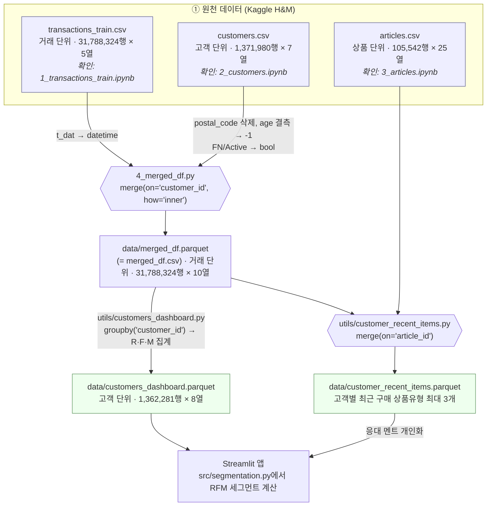
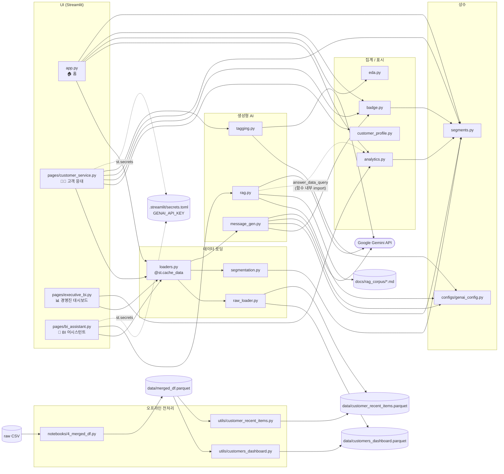
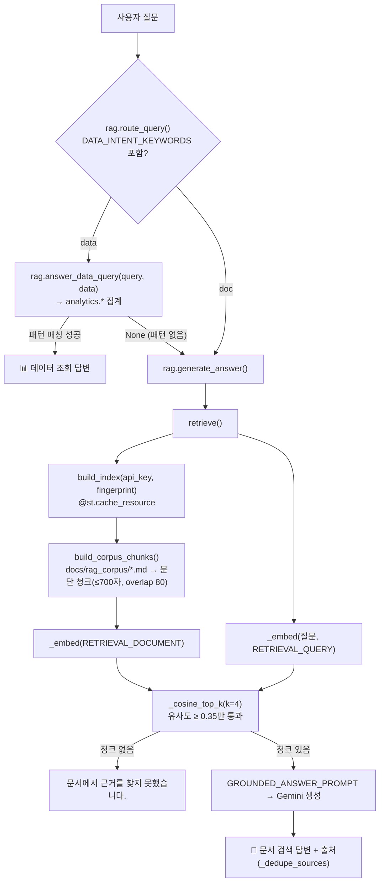

# 데이터 전처리·통합 과정

- 출처: [Kaggle - H&M Personalized Fashion Recommendations](https://www.kaggle.com/competitions/h-and-m-personalized-fashion-recommendations/data)
- 내용: H&M 고객의 약 2년치(2018-09-20 ~ 2020-09-22) 구매 이력, 고객 메타데이터, 상품 메타데이터

## 목차

1. [폴더 구성](#1-폴더-구성)
2. [실행 방법](#2-실행-방법)
3. [데이터 생성 흐름](#3-데이터-생성-흐름)
4. [데이터셋 명세](#4-데이터셋-명세)
5. [코드 구조 (앱 전체)](#5-코드-구조-앱-전체)

---

## 1. 폴더 구성

| 파일 | 용도 | 입력 | 출력 |
|---|---|---|---|
| [1_transactions_train.ipynb](1_transactions_train.ipynb) | 거래 로그 확인 (형태·결측·중복·기간) | `transactions_train.csv` | - |
| [2_customers.ipynb](2_customers.ipynb) | 고객 메타데이터 확인 | `customers.csv` | - |
| [3_articles.ipynb](3_articles.ipynb) | 상품 메타데이터 확인 | `articles.csv` | - |
| [4_merged_df.py](4_merged_df.py) | 전처리 → `customer_id` 기준 병합 | `transactions_train.csv`, `customers.csv` | `data/merged_df.csv`, `data/merged_df.parquet` |

- **1~3번 노트북**은 원천 데이터를 확인하는 용도
- **4번 스크립트**는 병합 데이터(merged_df)를 만드는 코드
- 고객 단위 집계(`customers_dashboard.parquet`)는 [utils/customers_dashboard.py](../utils/customers_dashboard.py)가 담당

---

## 2. 실행 방법

### 2.1 원천 데이터 준비

- `transactions_train.csv`, `customers.csv`는 **구글 드라이브에서 자동으로 받는다** (2.2 참고). 따로 준비할 필요 없음.
- `articles.csv`(2.4에서 사용)는 Kaggle에서 받아 `data/`에 저장.

```
data/
  raw/                     # 4_merged_df.py가 구글 드라이브에서 받아 저장 (git 미포함)
    transactions_train.csv # 약 3.5GB
    customers.csv          # 약 207MB
  articles.csv
```

아래 명령은 모두 **프로젝트 루트**에서 실행한다.

### 2.2 병합 데이터 생성 (merged_df)

```bash
python notebooks/4_merged_df.py                      # 구글 드라이브에서 raw CSV를 받아서 사용 (기본)
python notebooks/4_merged_df.py --raw-dir <CSV폴더>   # 로컬에 이미 있는 raw CSV를 사용
```

| 단계 | 내용 |
|---|---|
| [1/3] | `transactions_train.csv`, `customers.csv` 로드. 기본은 구글 드라이브 → `data/raw/`로 다운로드 후 읽음 (이미 있으면 다운로드 생략) |
| [2/3] | customers·transactions 전처리 → `customer_id` 기준 병합 |
| [3/3] | `data/merged_df.csv`, `data/merged_df.parquet` 저장 |

> 3,179만 행을 다루므로 메모리가 넉넉해야 함(병합 결과 약 4.5GB).\
> 다운로드는 `.part` 파일로 받은 뒤 완료 시 이름을 바꾸므로, 중간에 끊겨도 다시 실행하면 처음부터 새로 받는다.\
> 드라이브 파일 ID는 스크립트 상단의 `transactions_ID`, `customer_ID`에 있다.

### 2.3 대시보드 데이터 생성

`merged_df.parquet`을 고객 단위로 집계한다. 2.2를 먼저 실행해야 한다.

```bash
python utils/customers_dashboard.py      # data/merged_df.parquet → data/customers_dashboard.parquet
```

### 2.4 (선택) 최근 구매 상품 데이터 생성

응대 멘트 개인화에 쓰는 `customer_recent_items.parquet`를 만든다. 2.2를 먼저 실행해야 한다.

```bash
python utils/customer_recent_items.py   # data/merged_df.parquet + data/articles.csv → data/customer_recent_items.parquet
```

---

## 3. 데이터 생성 흐름

### 3.1 흐름도



<details>
<summary>텍스트 버전 (Mermaid가 안 보일 때)</summary>

```
[원천]                   [notebooks/4_merged_df.py]                  [utils/customers_dashboard.py]                         [사용처]

transactions_train.csv ─┐
                        ├─ merge on customer_id ─► merged_df.parquet ─┬─ groupby customer_id ─► customers_dashboard.parquet ─► 대시보드 (RFM 세그먼트)
customers.csv ──────────┘   (+ merged_df.csv)                         │
                                                                      │  [utils/customer_recent_items.py]
articles.csv ─────────────────────────────────────────────────────────┴─ merge on article_id ─► customer_recent_items.parquet ─► 응대 멘트
```

</details>

### 3.2 행 단위(grain) 변화

| 파일 | 형식 | 행 단위 | 행 수 | 열 수 | 비고 |
|---|---|---|---|---|---|
| `transactions_train.csv` | CSV | 거래(고객×상품×날짜) | 31,788,324 | 5 | 약 3.2GB |
| `customers.csv` | CSV | 고객 | 1,371,980 | 7 | 구매 이력 없는 고객 포함 |
| `articles.csv` | CSV | 상품 | 105,542 | 25 | |
| `merged_df.parquet` | Parquet | 거래 | 31,788,324 | 10 | 중간 산출물 (= merged_df.csv) |
| `customers_dashboard.parquet` | Parquet | 고객 | 1,362,281 | 8 | **앱이 실제로 읽는 파일** |
| `customer_recent_items.parquet` | Parquet | 고객 | - | 2 | `customer_id`, `recent_items` |

### 3.3 참고

- **articles.csv는 RFM에 쓰이지 않음.** `merged_df.parquet`은 transactions + customers만 병합한 것이고, articles는 `customer_recent_items.parquet`에만 쓰임.
- **RFM 세그먼트(VIP, 충성 등)는 parquet에 저장되지 않는다.** 앱 로딩 시 [src/segmentation.py](../src/segmentation.py)에서 계산하므로 규칙을 바꿔도 parquet을 다시 만들 필요가 없음.
- 생성 순서는 `notebooks/4_merged_df.py` → `utils/customers_dashboard.py` (→ `utils/customer_recent_items.py`).

---

## 4. 데이터셋 명세

```
customers.csv ──(customer_id)──┐
                               ├── transactions_train.csv
articles.csv  ──(article_id)───┘
```

### 4.1 transactions_train.csv

**2018-09-20 ~ 2020-09-22** 동안의 구매 내역.\
각 row는 **"어떤 날짜에, 어떤 고객이, 어떤 상품을, 얼마에, 어느 채널에서 샀는가"** 를 의미.

- 영수증(주문) 단위가 아니라 **고객 × 상품 × 날짜** 단위로 기록됨.
- 수량 컬럼 없음. 같은 날 같은 고객이 같은 상품을 여러 개 사면 **동일한 row가 반복**된다. 즉, 중복 row는 구매 수량을 의미.

| 항목 | 값 |
|---|---|
| 파일 크기 | 약 3.2GB |
| 행 수 × 열 수 | 31,788,324 × 5 |
| 기간 | 2018-09-20 ~ 2020-09-22 |

| 컬럼 | 타입(권장) | 설명 |
|---|---|---|
| `t_dat` | datetime | 구매 날짜 |
| `customer_id` | str | 고객 ID (64자리 해시). `customers.csv`와 연결 |
| `article_id` | str | 상품 ID. `articles.csv`와 연결 |
| `price` | float32 | 구매 가격 (스케일링된 값) |
| `sales_channel_id` | int8 | 판매 채널(1, 2). 공식 정의는 없으며 보통 1=매장, 2=온라인으로 해석 |

<details>
<summary>샘플</summary>

| | t_dat | customer_id | article_id | price | sales_channel_id |
|---|---|---|---|---|---|
| 0 | 2018-09-20 | 000058a12d5b43e67d225668fa1f8d618c13dc232df0ca... | 663713001 | 0.050831 | 2 |
| 1 | 2018-09-20 | 000058a12d5b43e67d225668fa1f8d618c13dc232df0ca... | 541518023 | 0.030492 | 2 |
| 2 | 2018-09-20 | 00007d2de826758b65a93dd24ce629ed66842531df6699... | 505221004 | 0.015237 | 2 |

</details>

### 4.2 customers.csv

고객 1명당 1 row인 **고객 메타데이터**.\
각 row는 **"고객이 몇 살이고, 어떤 멤버십 상태이며, 패션 뉴스를 얼마나 받아보는가"** 를 의미.

- 구매 이력이 없는 고객도 포함되어 있음. 즉, `customers.csv`의 고객 수 ≥ 거래 로그에 등장하는 고객 수.
- `FN`, `Active`는 0/1이 아니라 **1 또는 결측(NaN)** 으로 기록됨. 결측은 "해당 없음"으로 해석.

| 항목 | 값 |
|---|---|
| 메모리 사용량 | 256.7MB |
| 행 수 × 열 수 | 1,371,980 × 7 |

| 컬럼 | 타입(권장) | 설명 | 결측 |
|---|---|---|---|
| `customer_id` | str | 고객 ID (64자리 해시). `transactions_train.csv`와 연결 | 0 |
| `FN` | float32 | Fashion News 구독 여부. 1 또는 NaN | 895,050 (65.2%) |
| `Active` | float32 | 커뮤니케이션 활성 여부. 1 또는 NaN. 공식 정의는 없음 | 907,576 (66.2%) |
| `club_member_status` | category | 멤버십 상태. `ACTIVE`, `PRE-CREATE`, `LEFT CLUB` | 6,062 (0.4%) |
| `fashion_news_frequency` | category | 패션 뉴스 수신 빈도. `NONE`, `Regularly`, `Monthly` 등 | 16,011 (1.2%) |
| `age` | float32 | 나이. 16 ~ 99세, 평균 36.4세, 중앙값 32세 | 15,861 (1.2%) |
| `postal_code` | str | 우편번호 (해시) | 0 |

<details>
<summary>샘플</summary>

| | customer_id | FN | Active | club_member_status | fashion_news_frequency | age | postal_code |
|---|---|---|---|---|---|---|---|
| 0 | 00000dbacae5abe5e23885899a1fa44253a17956c6d1c3... | NaN | NaN | ACTIVE | NONE | 49.0 | 52043ee2162cf5aa7ee79974281641c6f11a68d276429a... |
| 1 | 0000423b00ade91418cceaf3b26c6af3dd342b51fd051e... | NaN | NaN | ACTIVE | NONE | 25.0 | 2973abc54daa8a5f8ccfe9362140c63247c5eee03f1d93... |
| 4 | 00006413d8573cd20ed7128e53b7b13819fe5cfc2d801f... | 1.0 | 1.0 | ACTIVE | Regularly | 52.0 | 25fa5ddee9aac01b35208d01736e57942317d756b32ddd... |

</details>

### 4.3 articles.csv

상품 1개(색상·변형 단위)당 1 row인 **상품 메타데이터**.\
각 row는 **"이 상품이 어떤 제품이고, 어떤 종류·색상·부서에 속하는가"** 를 의미.

- `article_id` = `product_code` + 3자리 변형 번호. `product_code`는 같은 제품, `article_id`는 그 제품의 색상·변형 단위.
  - 예: `article_id` 108775015 → `product_code` 108775
- 대부분의 속성이 **코드(`_no`, `_code`, `_id`)와 이름(`_name`) 쌍**으로 구성된다. 분석 시 둘 중 하나만 쓰면 됨.
- 일부 코드 컬럼(`product_type_no`, `graphical_appearance_no`, `colour_group_code`, `perceived_colour_*`)에 **-1** 값이 있음. 미분류 값으로 추정됨.

| 항목 | 값 |
|---|---|
| 메모리 사용량 | 47.7MB |
| 행 수 × 열 수 | 105,542 × 25 |

| 구분 | 코드 컬럼 | 이름 컬럼 | 설명 |
|---|---|---|---|
| 식별자 | `article_id` | - | 상품 ID. `transactions_train.csv`와 연결 |
| 제품 | `product_code` | `prod_name` | 제품 코드 / 제품명 |
| 제품 유형 | `product_type_no` | `product_type_name` | 세부 유형 (예: Vest top, Bra) |
| 제품 그룹 | - | `product_group_name` | 상위 유형 그룹 (예: Garment Upper body, Underwear) |
| 외관 | `graphical_appearance_no` | `graphical_appearance_name` | 패턴·무늬 (예: Solid, Stripe) |
| 색상 | `colour_group_code` | `colour_group_name` | 세부 색상 (예: Black, White, Off White) |
| 색상 명도 | `perceived_colour_value_id` | `perceived_colour_value_name` | 밝기 계열 |
| 색상 계열 | `perceived_colour_master_id` | `perceived_colour_master_name` | 대표 색상 계열 |
| 부서 | `department_no` | `department_name` | 담당 부서 (예: Jersey Basic, Clean Lingerie) |
| 인덱스 | `index_code` | `index_name` | 상품 라인 (예: A=Ladieswear, B=Lingeries/Tights) |
| 인덱스 그룹 | `index_group_no` | `index_group_name` | 상위 라인 (예: 1=Ladieswear) |
| 섹션 | `section_no` | `section_name` | 매장 섹션 (예: Womens Everyday Basics) |
| 의류 그룹 | `garment_group_no` | `garment_group_name` | 의류 분류 (예: Jersey Basic, Under-, Nightwear) |
| 설명 | - | `detail_desc` | 상품 상세 설명(텍스트). 결측 416건 (0.4%) |

<details>
<summary>샘플 (주요 컬럼)</summary>

| | article_id | product_code | prod_name | product_type_name | product_group_name | graphical_appearance_name | colour_group_name | index_group_name | section_name |
|---|---|---|---|---|---|---|---|---|---|
| 0 | 108775015 | 108775 | Strap top | Vest top | Garment Upper body | Solid | Black | Ladieswear | Womens Everyday Basics |
| 1 | 108775044 | 108775 | Strap top | Vest top | Garment Upper body | Solid | White | Ladieswear | Womens Everyday Basics |
| 2 | 108775051 | 108775 | Strap top (1) | Vest top | Garment Upper body | Stripe | Off White | Ladieswear | Womens Everyday Basics |
| 3 | 110065001 | 110065 | OP T-shirt (Idro) | Bra | Underwear | Solid | Black | Ladieswear | Womens Lingerie |

- 0~2행은 같은 `product_code`(108775)의 색상·패턴 변형. `article_id` 뒤 3자리만 다름.

</details>

### 4.4 merged_df.parquet (merged_df)

`transactions_train.csv`에 `customers.csv`의 고객 속성을 붙인 **거래 단위 통합 데이터**.\
각 row는 **"어떤 날짜에, 어떤 고객이, 어떤 상품을, 얼마에, 어느 채널에서 샀는가 + 그 고객은 누구인가"** 를 의미.

- 거래 1건당 1 row. 행 수는 `transactions_train.csv`와 같음(31,788,324).
- 구매 이력이 없는 고객 9,699명은 포함되지 않음.

| 단계 | 내용 |
|---|---|
| customers 전처리 | `postal_code` 삭제 |
| | `age`: 결측 → **-1** |
| | `FN`, `Active`: 결측 → False, 1 → True (bool) |
| transactions 전처리 | `t_dat` → datetime 변환 |
| 병합 | `customer_id` 기준 inner join. 거래 고객이 모두 customers에 있어 left join과 결과가 같음 |

| 항목 | 값 |
|---|---|
| 메모리 사용량 | 4.5GB |
| 행 수 × 열 수 | 31,788,324 × 10 |

| 컬럼 | 타입 | 출처 | 설명 |
|---|---|---|---|
| `t_dat` | datetime | transactions | 구매 날짜 |
| `customer_id` | str | transactions | 고객 ID (64자리 해시) |
| `article_id` | int64 | transactions | 상품 ID. `articles.csv`와 연결 |
| `price` | float64 | transactions | 구매 가격 |
| `sales_channel_id` | int64 | transactions | 판매 채널(1, 2) |
| `FN` | bool | customers | Fashion News 구독 여부 |
| `Active` | bool | customers | 커뮤니케이션 활성 여부 |
| `club_member_status` | str | customers | 멤버십 상태. 결측 있음 |
| `fashion_news_frequency` | str | customers | 패션 뉴스 수신 빈도. 결측 있음 |
| `age` | int64 | customers | 나이. **-1 = 결측** |

### 4.5 customers_dashboard.parquet

`merged_df.parquet`(거래 단위)를 `customer_id`로 집계한 **고객 단위 요약 테이블**이며, 대시보드가 실제로 읽는 파일.\
각 row는 **"이 고객은 누구이고, 언제 마지막으로 샀고, 몇 개를 샀고, 얼마를 썼는가"** 를 의미.

- 고객 1명당 1 row. 3,179만 행이 136만 행으로 줄어 Streamlit Cloud에서도 로딩할 수 있음.
- 구매 이력이 있는 고객만 포함됨(1,362,281명).

| 결과 컬럼 | 계산 | 비고 |
|---|---|---|
| `age`, `club_member_status`, `fashion_news_frequency` | `first` | 고객 속성은 모든 거래 row에서 같으므로 대표값 1개 |
| `last_purchase` | `t_dat`의 `max` | 마지막 구매일 |
| `purchase_count` | `t_dat`의 `count` | **F (Frequency)** |
| `total_spent` | `price`의 `sum` | **M (Monetary)** |
| `days_since_last_purchase` | `ref_date - last_purchase` | **R (Recency)**, 일 단위 |

- `ref_date`는 데이터 내 가장 최근 거래일(**2020-09-22**)이다. 2020년 스냅샷이므로 오늘 날짜가 아닌 데이터 종료일을 기준으로 함.

| 컬럼 | 타입 | 설명 |
|---|---|---|
| `customer_id` | str | 고객 ID (64자리 해시) |
| `age` | int64 | 나이. **-1 = 결측** (15,761명) |
| `club_member_status` | str | 멤버십 상태(`ACTIVE`, `PRE-CREATE`, `LEFT CLUB`). 결측 있음 |
| `fashion_news_frequency` | str | 패션 뉴스 수신 빈도(`NONE`, `Regularly`, `Monthly`). 결측 있음 |
| `last_purchase` | datetime | 마지막 구매일 |
| `purchase_count` | int64 | 구매 상품 개수 (F) |
| `total_spent` | float64 | 총 구매액 (M). 스케일링된 값 |
| `days_since_last_purchase` | int64 | 마지막 구매 후 경과일 (R). 작을수록 최근 |

<details>
<summary>샘플</summary>

| | customer_id | age | club_member_status | fashion_news_frequency | last_purchase | purchase_count | total_spent | days_since_last_purchase |
|---|---|---|---|---|---|---|---|---|
| 0 | 00000dbacae5abe5e23885899a1fa44253a17956c6d1c3... | 49 | ACTIVE | NONE | 2020-09-05 | 21 | 0.648983 | 17 |
| 1 | 0000423b00ade91418cceaf3b26c6af3dd342b51fd051e... | 25 | ACTIVE | NONE | 2020-07-08 | 86 | 2.601932 | 76 |
| 2 | 000058a12d5b43e67d225668fa1f8d618c13dc232df0ca... | 24 | ACTIVE | NONE | 2020-09-15 | 18 | 0.704780 | 7 |
| 3 | 00005ca1c9ed5f5146b52ac8639a40ca9d57aeff4d1bd2... | 54 | ACTIVE | NONE | 2019-06-09 | 2 | 0.060983 | 471 |

</details>

#### 주의사항

- **`purchase_count`는 방문 횟수가 아니라 구매 상품 개수다.** 같은 날 5개를 사면 5로 집계된다. 방문 횟수가 필요하면 `('t_dat', 'nunique')`를 씀.
- **`age = -1`은 결측이다.** 연령 차트나 평균을 계산할 때는 `age >= 0`으로.

---

## 5. 코드 구조 (앱 전체)

생성된 parquet을 앱의 `.py` 파일들이 **어떻게 읽고 서로 호출하는지** 정리.

### 5.1 레이어 구성

```
┌──────────────────────────────────────────────────────────────────────┐
│ [오프라인]  notebooks/4_merged_df.py · utils/                         │
│            원천 데이터 → parquet 생성 (한 번만 실행)                   │
└──────────────────────────────────────────────────────────────────────┘
                                   │ data/*.parquet
                                   ▼
┌──────────────────────────────────────────────────────────────────────┐
│ [데이터]    src/raw_loader → src/segmentation → src/loaders (캐시)      │
├──────────────────────────────────────────────────────────────────────┤
│ [로직]      analytics · customer_profile · badge · eda                │
│ [AI]        tagging · message_gen · rag          ──► Google Gemini API │
│ [상수]      segments · configs/genai_config                           │
├──────────────────────────────────────────────────────────────────────┤
│ [UI]        app.py · pages/customer_service · executive_bi · bi_assistant │
└──────────────────────────────────────────────────────────────────────┘
```

### 5.2 의존성 흐름도

화살표 `A --> B` = "A가 B를 import/호출한다".



### 5.3 페이지별 실행 흐름

#### 공통: 데이터 로딩 (모든 페이지가 맨 먼저 호출)

```
load_customers()                       src/loaders.py  (@st.cache_data → 세션 간 1회만 실행)
 ├─ load_raw_customers()               src/raw_loader.py
 │   ├─ read_parquet('data/customers_dashboard.parquet')        고객 1,362,281행
 │   └─ (있으면) merge 'data/customer_recent_items.parquet'      + recent_items 컬럼
 └─ assign_segments(df)                src/segmentation.py
     ├─ r_score / f_score / m_score   (qcut 4분위, R은 역순)
     └─ segment                       (VIP → 이탈위험 → 충성 → 신규 → 일반 순서로 판정)
→ 반환: 고객 DataFrame (+ r_score, f_score, m_score, segment)
```

#### 🏠 `app.py` — 홈

```
load_customers()
 ├─ analytics.overall_kpis(data)       (계산만 하고 현재 화면엔 미사용)
 ├─ segment_badge(seg) × SEGMENT_ORDER  src/badge.py  → 세그먼트 안내 뱃지
 └─ dist_age(data)                      src/eda.py    → 연령별 bar chart
st.page_link → pages/*.py 3개로 이동
```

#### 🧑‍💼 `pages/customer_service.py` — 고객 응대

```
load_customers()
 │
 ├─ [입력] customer_id
 ├─ get_customer_profile(customer_id, data)          src/customer_profile.py
 │    → profile dict (RFM, 인구통계, segment, recent_items[])
 │    → None이면 "거래 내역 없음" 후 st.stop()
 │
 ├─ 프로필 표시
 │    club_status_badge / news_frequency_badge       src/badge.py
 │    SEGMENT_COLORS                                 src/segments.py
 │
 ├─ [버튼] 🏷️ 태그 생성
 │    memo2tags(memo, api_key)                       src/tagging.py ──► Gemini
 │    → st.session_state['tags_{id}'] = ['fit:slim', ...]  (최대 5개)
 │
 └─ [버튼] ✨ 토킹포인트 생성
      cached_talking_points(id, tuple(tags), profile, api_key)   src/loaders.py (@st.cache_data)
       └─ generate_talking_points(profile, tags, api_key)        src/message_gen.py ──► Gemini
            SEGMENT_GUIDE[segment] + 고객 정보 + 태그 + recent_items → 프롬프트
            → 100~150자 대면 응대 멘트
```

- 캐시 키는 `(customer_id, tags)`이다. `_profile`, `_api_key`는 언더스코어 접두어로 **해시 대상에서 제외**.

#### 📊 `pages/executive_bi.py` — 경영진 대시보드

```
load_customers()
 ├─ analytics.overall_kpis(data)          → 전체 고객 수 / 평균·총 구매금액
 ├─ analytics.segment_distribution(data)  → 세그먼트별 count, pct (SEGMENT_ORDER 정렬)
 └─ analytics.segment_rfm_summary(data)   → 세그먼트별 R·F·M 원값 평균
```

#### 🤖 `pages/bi_assistant.py` — BI 어시스턴트 (RAG)



- `_corpus_fingerprint()`는 코퍼스 파일들의 mtime 문자열. 문서를 수정하면 지문이 바뀌어 **인덱스 캐시가 자동으로 무효화**됨.
- 대화 기록은 `st.session_state['rag_history']`에 저장.

### 5.4 파일별 상세

#### UI

| 파일 | 역할 | import |
|---|---|---|
| [app.py](../app.py) | 홈. 페이지 안내, 세그먼트 소개, 연령 분포 | `loaders`, `analytics`, `eda`, `badge`, `segments` |
| [pages/customer_service.py](../pages/customer_service.py) | 고객 조회 → 메모 태깅 → 토킹포인트 | `loaders`, `customer_profile`, `badge`, `segments`, `tagging` |
| [pages/executive_bi.py](../pages/executive_bi.py) | KPI, 세그먼트 분포, RFM 요약 | `loaders`, `analytics` |
| [pages/bi_assistant.py](../pages/bi_assistant.py) | RAG 챗봇 + 데이터 질문 라우팅 | `rag`, `loaders` |

#### `src/` — 데이터

| 파일 | 주요 함수 | 입력 → 출력 | 비고 |
|---|---|---|---|
| [raw_loader.py](../src/raw_loader.py) | `load_raw_customers()` | parquet 2개 → DataFrame | recent_items 파일이 없으면 merge 생략 |
| [segmentation.py](../src/segmentation.py) | `assign_segments(df)` | DataFrame → + `r/f/m_score`, `segment` | R·F는 `rank(method='first')` 후 qcut (동점 처리) |
| [loaders.py](../src/loaders.py) | `load_customers()`<br/>`cached_talking_points(...)` | - | **Streamlit 캐시 계층**. 페이지는 여기서만 데이터를 가져감 |

#### `src/` — 집계 / 표시

| 파일 | 주요 함수 | 반환 | 사용처 |
|---|---|---|---|
| [analytics.py](../src/analytics.py) | `overall_kpis`<br/>`segment_distribution`<br/>`segment_rfm_summary` | dict / DataFrame | `app`, `executive_bi`, `rag.answer_data_query` |
| [customer_profile.py](../src/customer_profile.py) | `get_customer_profile(id, data)` | dict 또는 `None` | `customer_service` |
| [badge.py](../src/badge.py) | `club_status_badge`, `news_frequency_badge`, `news_frequency_label`, `segment_badge` | Streamlit 색상 마크다운 `:color[**text**]` | `app`, `customer_service`, `message_gen` |
| [eda.py](../src/eda.py) | `dist_age(df)` | 연령별 고객 수 Series | `app` |

#### `src/` — 생성형 AI (Gemini)

| 파일 | 주요 함수 | Gemini 호출 | 출력 |
|---|---|---|---|
| [tagging.py](../src/tagging.py) | `memo2tags(memo, api_key)` | `generate_content` | 태그 리스트(최대 5개). JSON 파싱 실패 시 `[]` |
| [message_gen.py](../src/message_gen.py) | `generate_talking_points(profile, tags, api_key, personalized=True)` | `generate_content` (temperature 0.7) | 응대 멘트 문자열. `personalized=False`는 평가용 baseline |
| [rag.py](../src/rag.py) | `generate_answer`, `retrieve`, `build_index`, `route_query`, `answer_data_query` | `embed_content`, `generate_content` | `{'answer', 'sources'}` |

#### 상수 / 설정

| 파일 | 내용 | 사용처 |
|---|---|---|
| [src/segments.py](../src/segments.py) | 세그먼트 이름(`VIP`, `CHURN_RISK`...), `SEGMENT_ORDER`, `SEGMENT_COLORS` | `segmentation`, `analytics`, `badge`, `message_gen`, `app`, `customer_service` |
| [configs/genai_config.py](../configs/genai_config.py) | `DEFAULT_GENAI_MODEL`, `DEFAULT_EMBEDDING_MODEL` | `tagging`, `message_gen`, `rag` |
| `.streamlit/secrets.toml` | `GENAI_API_KEY` | `customer_service`, `bi_assistant` (git 미포함) |

> 세그먼트 이름을 바꾸려면 `segments.py`만 수정하면 된다. 단, [app.py](../app.py)의 `SEGMENT_DESC`는 한글 문자열을 직접 키로 쓰므로 함께 수정해야 한다.

#### 오프라인 스크립트

| 파일 | 입력 | 출력 |
|---|---|---|
| [notebooks/4_merged_df.py](4_merged_df.py) | `transactions_train.csv`, `customers.csv` | `data/merged_df.csv`, `data/merged_df.parquet` |
| [utils/customers_dashboard.py](../utils/customers_dashboard.py) | `data/merged_df.parquet` | `data/customers_dashboard.parquet` |
| [utils/customer_recent_items.py](../utils/customer_recent_items.py) | `data/merged_df.parquet`, `data/articles.csv` | `data/customer_recent_items.parquet` |

- 앱 실행 중에는 호출되지 않는다.

#### 스텁

| 파일 | 상태 |
|---|---|
| `src/agent.py`, `configs/config.py`, `models/model.py` | `import numpy` 한 줄짜리 빈 스텁. 어디서도 import되지 않음 |

### 5.5 자주 하는 수정 → 손댈 파일

| 하고 싶은 것 | 수정할 파일 | parquet 재생성? |
|---|---|---|
| 세그먼트 규칙·경계 변경 | `src/segmentation.py` | ❌ (앱 재시작만) |
| 세그먼트 이름·색상 변경 | `src/segments.py` (+ `app.py`의 `SEGMENT_DESC`) | ❌ |
| 고객 단위 집계 컬럼 추가 (예: 채널 선호) | `utils/customers_dashboard.py` → `customer_profile.py`/`analytics.py` | ✅ (`utils/customers_dashboard.py`만 다시 실행) |
| 응대 멘트 톤·규칙 변경 | `src/message_gen.py` (`SEGMENT_GUIDE`, `COMMON_RULES`) | ❌ |
| Gemini 모델 교체 | `configs/genai_config.py` | ❌ |
| RAG 문서 추가·수정 | `docs/rag_corpus/*.md` | ❌ (mtime으로 자동 재인덱싱) |
| 데이터 질문 라우팅 키워드 추가 | `src/rag.py` (`DATA_INTENT_KEYWORDS`, `answer_data_query`) | ❌ |
| 새 페이지 추가 | `pages/새페이지.py` + `app.py`에 `st.page_link` | ❌ |

### 5.6 디버깅 팁

- **Streamlit 없이 세그먼트 확인**: `loaders.py` 대신 `raw_loader` + `segmentation`을 직접 import한다. `loaders`/`rag`를 노트북에서 import하면 캐시 데코레이터 경고가 뜰 수 있다.
  ```python
  from src.raw_loader import load_raw_customers
  from src.segmentation import assign_segments

  df = assign_segments(load_raw_customers())
  print(df['segment'].value_counts(normalize=True).round(3))
  ```
- **노트북에서 `src` import**: 프로젝트 루트가 `sys.path`에 있어야 하고, 데이터 경로(`data/...`)가 상대경로이므로 **작업 디렉토리도 루트**여야 한다.
  ```python
  import os, sys
  os.chdir('..'); sys.path.insert(0, os.getcwd())
  ```
- **캐시가 갱신되지 않을 때**: parquet을 다시 만들었는데 앱에 옛 데이터가 보이면 Streamlit 메뉴 → *Clear cache*를 누른다 (`load_customers`는 `@st.cache_data`).
- **AI 기능 단독 테스트**: `memo2tags`, `generate_talking_points`는 `api_key`를 인자로 받으므로 `st.secrets` 없이 문자열 키로 바로 호출할 수 있다.
