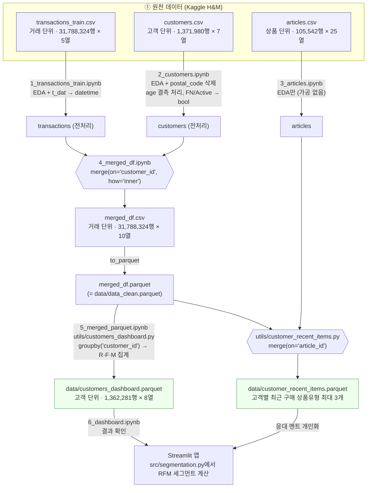

# 데이터 생성 흐름

원천 CSV 3개 → 거래 통합 데이터 → 고객 단위 RFM 데이터 → 대시보드까지의 **생성 순서**를 정리한 문서.\
각 파일의 컬럼 명세·샘플은 [README.md](README.md) 참고.

---

## 1. 전체 흐름도



<details>
<summary>텍스트 버전 (Mermaid가 안 보일 때)</summary>

```
[원천]                         [전처리 / 병합]                         [집계]                               [사용처]

transactions_train.csv ─(1)─┐
                            ├─(4) merge on customer_id ─► merged_df.csv ─► merged_df.parquet ─┬─(5) groupby customer_id ─► customers_dashboard.parquet ─► 대시보드
customers.csv ─────────(2)──┘                                (= data_clean.parquet)          │                                                       (RFM 세그먼트)
                                                                                             │
articles.csv ──────────(3)───────────────────────────────────────────────────────────────────┴─ merge on article_id ─► customer_recent_items.parquet ─► 응대 멘트
```

</details>

---

## 2. 단계별 요약

| 순서 | 노트북 / 스크립트 | 입력 | 처리 | 출력 | 단위 · 크기 |
|---|---|---|---|---|---|
| 1 | [1_transactions_train.ipynb](1_transactions_train.ipynb) | `transactions_train.csv` | 로드, EDA(결측·중복·기간 확인) | (메모리) `transactions_train` | 거래 · 31,788,324행 × 5열 |
| 2 | [2_customers.ipynb](2_customers.ipynb) | `customers.csv` | 로드, EDA | (메모리) `customers` | 고객 · 1,371,980행 × 7열 |
| 3 | [3_articles.ipynb](3_articles.ipynb) | `articles.csv` | 로드, EDA | (메모리) `articles` | 상품 · 105,542행 × 25열 |
| 4 | [4_merged_df.ipynb](4_merged_df.ipynb) | 1, 2의 결과 | customers 전처리 → `t_dat` datetime 변환 → `customer_id` inner join | `merged_df.csv`, `merged_df.parquet` | 거래 · 31,788,324행 × 10열 |
| 5 | [5_merged_parquet.ipynb](5_merged_parquet.ipynb)<br/>([utils/customers_dashboard.py](../utils/customers_dashboard.py)) | `merged_df.parquet` | `customer_id`로 groupby → R·F·M 원값 계산 | `data/customers_dashboard.parquet` | 고객 · 1,362,281행 × 8열 |
| 6 | [6_dashboard.ipynb](6_dashboard.ipynb) | `customers_dashboard.parquet` | 결과 확인 | - | - |
| 별도 | [utils/customer_recent_items.py](../utils/customer_recent_items.py) | `merged_df.parquet` + `articles.csv` | `article_id`로 상품유형 연결 → 고객별 최근 3개 | `data/customer_recent_items.parquet` | 고객 |

---

## 3. 파일별 형태 변화

데이터의 **행 단위(grain)** 가 어떻게 바뀌는지가 핵심.

```
거래 단위 (31.8M행)                                  고객 단위 (1.36M행)
┌──────────────────────────┐                        ┌───────────────────────────────┐
│ transactions_train.csv   │                        │ customers_dashboard.parquet   │
│  t_dat, customer_id,     │                        │  customer_id                  │
│  article_id, price,      │   + 고객 속성           │  age, club_member_status,     │
│  sales_channel_id        │ ─────────►  merged_df ─►│  fashion_news_frequency       │
└──────────────────────────┘   (10열)    groupby    │  last_purchase                │
┌──────────────────────────┐                        │  purchase_count          (F)  │
│ customers.csv            │                        │  total_spent             (M)  │
│  FN, Active, age,        │                        │  days_since_last_purchase(R)  │
│  club_member_status, ... │                        └───────────────────────────────┘
└──────────────────────────┘
```

| 파일 | 형식 | 행 단위 | 행 수 | 열 수 | 비고 |
|---|---|---|---|---|---|
| `transactions_train.csv` | CSV | 거래(고객×상품×날짜) | 31,788,324 | 5 | 약 3.2GB |
| `customers.csv` | CSV | 고객 | 1,371,980 | 7 | 구매 이력 없는 고객 포함 |
| `articles.csv` | CSV | 상품 | 105,542 | 25 | |
| `merged_df.csv` | CSV | 거래 | 31,788,324 | 10 | 중간 산출물 |
| `merged_df.parquet` | Parquet | 거래 | 31,788,324 | 10 | `data_clean.parquet`과 동일 파일 |
| `customers_dashboard.parquet` | Parquet | 고객 | 1,362,281 | 8 | **앱이 실제로 읽는 파일** |
| `customer_recent_items.parquet` | Parquet | 고객 | - | 2 | `customer_id`, `recent_items` |

---

## 4. 참고

- **articles.csv는 RFM 흐름에 쓰이지 않는다.** `merged_df`는 transactions + customers만 병합한 것이고, articles는 `customer_recent_items.parquet`(응대 멘트용)에만 사용된다.
- **`merged_df.parquet` = `data_clean.parquet`.** `utils/` 스크립트는 `data/data_clean.parquet` 경로로 읽는다.
- **4번 노트북은 1·2번의 메모리 변수(`transactions_train`, `customers`)를 전제로 한다.** 4번만 단독 실행하면 병합 셀에서 `NameError`가 난다.
- **RFM 세그먼트(VIP, 충성 등)는 parquet에 저장되지 않는다.** 앱 로딩 시 [src/segmentation.py](../src/segmentation.py)에서 계산한다.
- 원천 CSV와 `merged_df.*`는 용량 때문에 저장소에 포함되지 않는다(`data/`에는 parquet 2개만 있음).
