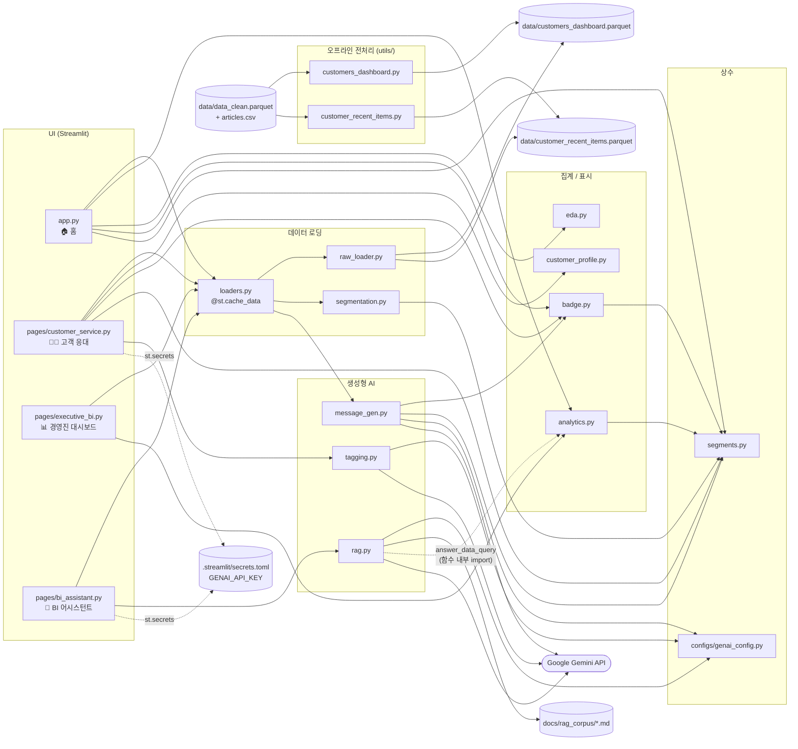
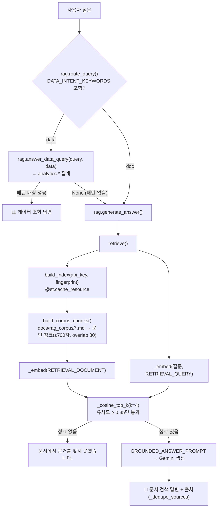

# 코드 구조 (개발자용)

솔루션 전체 `.py` 파일이 **어떻게 서로 호출·의존하는지** 정리한 문서.

| 문서 | 다루는 것 |
|---|---|
| [README.md](README.md) | 데이터셋 컬럼 명세·샘플 |
| [README2.md](README2.md) | 데이터 생성 순서 (CSV → parquet) |
| **README3.md** | 코드 구조 (`.py` 간 연결) |

> `notebooks/`는 이 솔루션의 구현 과정을 `.ipynb`로 재현·확인하는 **개발자 전용 작업 공간**이다. 앱은 notebooks를 import하지 않는다.

---

## 1. 레이어 구성

```
┌──────────────────────────────────────────────────────────────────────┐
│ [오프라인]  utils/            원천 데이터 → parquet 생성 (한 번만 실행)    │
└──────────────────────────────────────────────────────────────────────┘
                                   │ data/*.parquet
                                   ▼
┌──────────────────────────────────────────────────────────────────────┐
│ [데이터]    src/raw_loader → src/segmentation → src/loaders (캐시)      │
├──────────────────────────────────────────────────────────────────────┤
│ [로직]      analytics · customer_profile · badge · eda                │
│ [AI]        tagging · message_gen · rag          ──► Google Gemini API │
│ [상수]      segments · configs/genai_config                           │
├──────────────────────────────────────────────────────────────────────┤
│ [UI]        app.py · pages/customer_service · executive_bi · bi_assistant │
└──────────────────────────────────────────────────────────────────────┘
```

- 의존 방향은 **UI(맨 아래) → 로직·AI → 데이터** 단방향. `src/`끼리는 순환 import 없음.
- `streamlit`을 import하는 `src/` 모듈은 **`loaders.py`, `rag.py` 두 개뿐**(캐시 데코레이터 용도). 나머지는 순수 pandas/genai 함수라 노트북·스크립트에서 바로 import해서 테스트할 수 있다.

---

## 2. 전체 의존성 흐름도

화살표 `A --> B` = "A가 B를 import/호출한다".



---

## 3. 페이지별 실행 흐름

### 3.0 공통: 데이터 로딩 (모든 페이지가 맨 먼저 호출)

```
load_customers()                       src/loaders.py  (@st.cache_data → 세션 간 1회만 실행)
 ├─ load_raw_customers()               src/raw_loader.py
 │   ├─ read_parquet('data/customers_dashboard.parquet')        고객 1,362,281행
 │   └─ (있으면) merge 'data/customer_recent_items.parquet'      + recent_items 컬럼
 └─ assign_segments(df)                src/segmentation.py
     ├─ r_score / f_score / m_score   (qcut 4분위, R은 역순)
     └─ segment                       (VIP → 이탈위험 → 충성 → 신규 → 일반 순서로 판정)
→ 반환: 고객 DataFrame (+ r_score, f_score, m_score, segment)
```

> 세그먼트는 parquet에 저장되지 않고 **앱 로딩 시점에 계산**된다. 규칙을 바꿔도 parquet 재생성 불필요.

### 3.1 🏠 `app.py` — 홈

```
load_customers()
 ├─ analytics.overall_kpis(data)       (계산만 하고 현재 화면엔 미사용)
 ├─ segment_badge(seg) × SEGMENT_ORDER  src/badge.py  → 세그먼트 안내 뱃지
 └─ dist_age(data)                      src/eda.py    → 연령별 bar chart
st.page_link → pages/*.py 3개로 이동
```

### 3.2 🧑‍💼 `pages/customer_service.py` — 고객 응대

```
load_customers()
 │
 ├─ [입력] customer_id
 ├─ get_customer_profile(customer_id, data)          src/customer_profile.py
 │    → profile dict (RFM, 인구통계, segment, recent_items[])
 │    → None이면 "거래 내역 없음" 후 st.stop()
 │
 ├─ 프로필 표시
 │    club_status_badge / news_frequency_badge       src/badge.py
 │    SEGMENT_COLORS                                 src/segments.py
 │
 ├─ [버튼] 🏷️ 태그 생성
 │    memo2tags(memo, api_key)                       src/tagging.py ──► Gemini
 │    → st.session_state['tags_{id}'] = ['fit:slim', ...]  (최대 5개)
 │
 └─ [버튼] ✨ 토킹포인트 생성
      cached_talking_points(id, tuple(tags), profile, api_key)   src/loaders.py (@st.cache_data)
       └─ generate_talking_points(profile, tags, api_key)        src/message_gen.py ──► Gemini
            SEGMENT_GUIDE[segment] + 고객 정보 + 태그 + recent_items → 프롬프트
            → 100~150자 대면 응대 멘트
```

- 캐시 키는 `(customer_id, tags)`. `_profile`, `_api_key`는 언더스코어 접두어로 **해시 대상에서 제외**.

### 3.3 📊 `pages/executive_bi.py` — 경영진 대시보드

```
load_customers()
 ├─ analytics.overall_kpis(data)          → 전체 고객 수 / 평균·총 구매금액
 ├─ analytics.segment_distribution(data)  → 세그먼트별 count, pct (SEGMENT_ORDER 정렬)
 └─ analytics.segment_rfm_summary(data)   → 세그먼트별 R·F·M 원값 평균
```

### 3.4 🤖 `pages/bi_assistant.py` — BI 어시스턴트 (RAG)



- `_corpus_fingerprint()`는 코퍼스 파일들의 mtime 문자열. 문서를 수정하면 지문이 바뀌어 **인덱스 캐시가 자동 무효화**된다.
- 대화 기록은 `st.session_state['rag_history']`에 저장.

---

## 4. 파일별 상세

### 4.1 UI

| 파일 | 역할 | import |
|---|---|---|
| [app.py](../app.py) | 홈. 페이지 안내, 세그먼트 소개, 연령 분포 | `loaders`, `analytics`, `eda`, `badge`, `segments` |
| [pages/customer_service.py](../pages/customer_service.py) | 고객 조회 → 메모 태깅 → 토킹포인트 | `loaders`, `customer_profile`, `badge`, `segments`, `tagging` |
| [pages/executive_bi.py](../pages/executive_bi.py) | KPI, 세그먼트 분포, RFM 요약 | `loaders`, `analytics` |
| [pages/bi_assistant.py](../pages/bi_assistant.py) | RAG 챗봇 + 데이터 질문 라우팅 | `rag`, `loaders` |

### 4.2 `src/` — 데이터

| 파일 | 주요 함수 | 입력 → 출력 | 비고 |
|---|---|---|---|
| [raw_loader.py](../src/raw_loader.py) | `load_raw_customers()` | parquet 2개 → DataFrame | recent_items 파일이 없으면 merge 생략 |
| [segmentation.py](../src/segmentation.py) | `assign_segments(df)` | DataFrame → + `r/f/m_score`, `segment` | R·F는 `rank(method='first')` 후 qcut (동점 처리) |
| [loaders.py](../src/loaders.py) | `load_customers()`<br/>`cached_talking_points(...)` | - | **Streamlit 캐시 계층**. 페이지는 여기서만 데이터를 가져감 |

### 4.3 `src/` — 집계 / 표시

| 파일 | 주요 함수 | 반환 | 사용처 |
|---|---|---|---|
| [analytics.py](../src/analytics.py) | `overall_kpis`<br/>`segment_distribution`<br/>`segment_rfm_summary` | dict / DataFrame | `app`, `executive_bi`, `rag.answer_data_query` |
| [customer_profile.py](../src/customer_profile.py) | `get_customer_profile(id, data)` | dict 또는 `None` | `customer_service` |
| [badge.py](../src/badge.py) | `club_status_badge`, `news_frequency_badge`, `news_frequency_label`, `segment_badge` | Streamlit 색상 마크다운 `:color[**text**]` | `app`, `customer_service`, `message_gen` |
| [eda.py](../src/eda.py) | `dist_age(df)` | 연령별 고객 수 Series | `app` |

### 4.4 `src/` — 생성형 AI (Gemini)

| 파일 | 주요 함수 | Gemini 호출 | 출력 |
|---|---|---|---|
| [tagging.py](../src/tagging.py) | `memo2tags(memo, api_key)` | `generate_content` | 태그 리스트(최대 5개). JSON 파싱 실패 시 `[]` |
| [message_gen.py](../src/message_gen.py) | `generate_talking_points(profile, tags, api_key, personalized=True)` | `generate_content` (temperature 0.7) | 응대 멘트 문자열. `personalized=False`는 평가용 baseline |
| [rag.py](../src/rag.py) | `generate_answer`, `retrieve`, `build_index`, `route_query`, `answer_data_query` | `embed_content`, `generate_content` | `{'answer', 'sources'}` |

### 4.5 상수 / 설정

| 파일 | 내용 | 사용처 |
|---|---|---|
| [src/segments.py](../src/segments.py) | 세그먼트 이름(`VIP`, `CHURN_RISK`...), `SEGMENT_ORDER`, `SEGMENT_COLORS` | `segmentation`, `analytics`, `badge`, `message_gen`, `app`, `customer_service` |
| [configs/genai_config.py](../configs/genai_config.py) | `DEFAULT_GENAI_MODEL`, `DEFAULT_EMBEDDING_MODEL` | `tagging`, `message_gen`, `rag` |
| `.streamlit/secrets.toml` | `GENAI_API_KEY` | `customer_service`, `bi_assistant` (git 미포함) |

> 세그먼트 이름을 바꾸려면 `segments.py`만 수정하면 된다. 단, [app.py](../app.py)의 `SEGMENT_DESC`는 한글 문자열을 직접 키로 쓰므로 함께 수정해야 한다.

### 4.6 오프라인 스크립트 (`utils/`)

| 파일 | 입력 | 출력 | 실행 |
|---|---|---|---|
| [customers_dashboard.py](../utils/customers_dashboard.py) | `data/data_clean.parquet` | `data/customers_dashboard.parquet` | `python utils/customers_dashboard.py` |
| [customer_recent_items.py](../utils/customer_recent_items.py) | `data/data_clean.parquet`, `data/articles.csv` | `data/customer_recent_items.parquet` | `python utils/customer_recent_items.py [tx_path] [articles_path]` |

- 앱 실행 중에는 호출되지 않는다. 생성 순서는 [README2.md](README2.md) 참고.

### 4.7 개발용 / 스텁

| 파일 | 상태 |
|---|---|
| [notebooks/test.py](test.py) | `raw_loader` + `segmentation`만으로 세그먼트 분포 확인 (Streamlit 없이 실행) |
| [notebooks/1~6_*.ipynb](.) | 데이터 생성 과정 재현 ([README2.md](README2.md)) |
| `src/agent.py`, `configs/config.py`, `models/model.py` | `import numpy` 한 줄짜리 빈 스텁. 어디서도 import되지 않음 |

---

## 5. 자주 하는 수정 → 손댈 파일

| 하고 싶은 것 | 수정할 파일 | 재생성 필요? |
|---|---|---|
| 세그먼트 규칙·경계 변경 | `src/segmentation.py` | ❌ (앱 재시작만) |
| 세그먼트 이름·색상 변경 | `src/segments.py` (+ `app.py`의 `SEGMENT_DESC`) | ❌ |
| 고객 단위 집계 컬럼 추가 (예: 채널 선호) | `utils/customers_dashboard.py` → `customer_profile.py`/`analytics.py` | ✅ parquet 재생성 |
| 응대 멘트 톤·규칙 변경 | `src/message_gen.py` (`SEGMENT_GUIDE`, `COMMON_RULES`) | ❌ |
| Gemini 모델 교체 | `configs/genai_config.py` | ❌ |
| RAG 문서 추가·수정 | `docs/rag_corpus/*.md` | ❌ (mtime으로 자동 재인덱싱) |
| 데이터 질문 라우팅 키워드 추가 | `src/rag.py` (`DATA_INTENT_KEYWORDS`, `answer_data_query`) | ❌ |
| 새 페이지 추가 | `pages/새페이지.py` + `app.py`에 `st.page_link` | ❌ |

---

## 6. 디버깅 팁

- **Streamlit 없이 로직만 확인**: `loaders.py` 대신 `raw_loader` + `segmentation`을 직접 import ([notebooks/test.py](test.py) 방식). `loaders`/`rag`를 노트북에서 import하면 캐시 데코레이터 경고가 뜰 수 있다.
- **노트북에서 `src` import**: 프로젝트 루트가 `sys.path`에 있어야 하고, 데이터 경로(`data/...`)가 상대경로이므로 **작업 디렉토리도 루트**여야 한다.
  ```python
  import os, sys
  os.chdir('..'); sys.path.insert(0, os.getcwd())
  ```
- **캐시가 안 갱신될 때**: parquet을 다시 만들었는데 앱이 옛 데이터를 보이면 Streamlit 메뉴 → *Clear cache* (`load_customers`는 `@st.cache_data`).
- **AI 기능 단독 테스트**: `memo2tags`, `generate_talking_points`는 `api_key`를 인자로 받으므로 `st.secrets` 없이 문자열 키로 바로 호출 가능.
